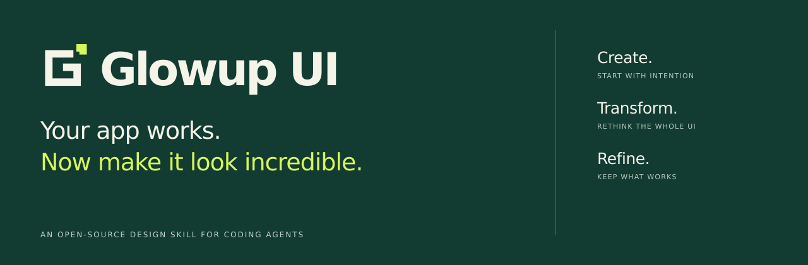
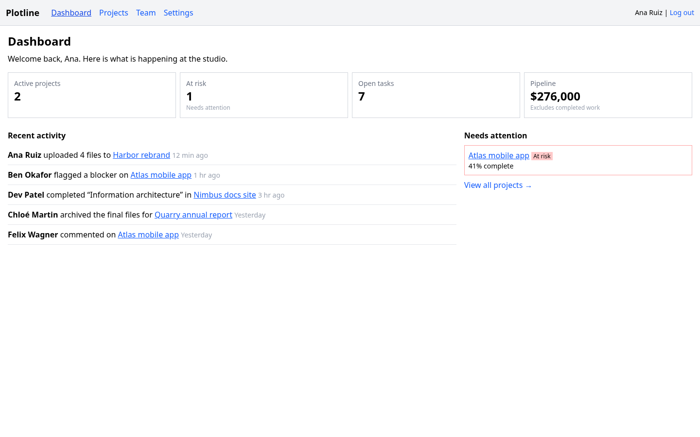
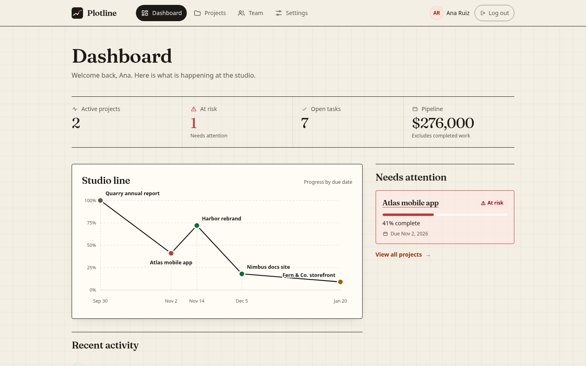
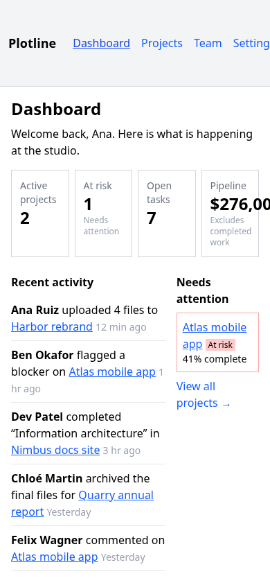
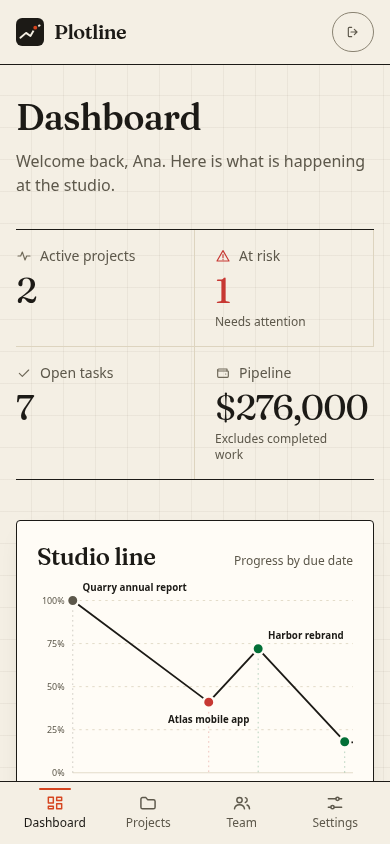
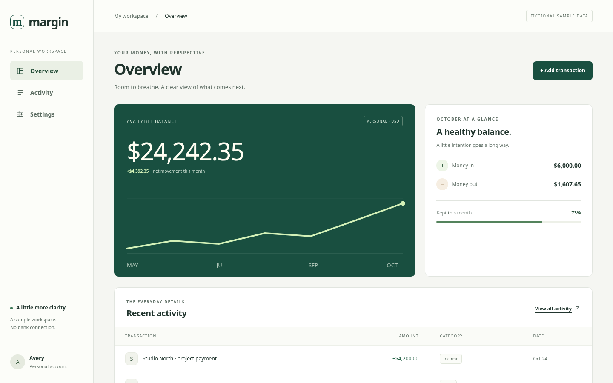

<picture>
  <source media="(max-width: 600px)" srcset="assets/brand/hero-mobile.svg">
  
</picture>

A portable design skill for coding agents. **Create a considered interface, transform an existing app, or refine what already works — while preserving functionality.**

[](https://github.com/avivgerz-hue/glowup-ui/actions/workflows/ci.yml) · [v0.1.1 · Public Preview](https://github.com/avivgerz-hue/glowup-ui/releases/tag/v0.1.1) · [MIT](LICENSE)

## Try it in your app

From your project, with Node 20+ and Git:

```bash
npx --yes --package=git+https://github.com/avivgerz-hue/glowup-ui.git#v0.1.1 glowup-ui install --agent codex --scope project
```

Then start a new Codex session and ask:

```text
$glowup-ui Transform this app across all pages. Improve composition, navigation,
 typography and shared components. Preserve routes, content, APIs and behavior.
 Inspect matching desktop and mobile screenshots before and after.
```

Claude Code: replace `codex` with `claude`, then invoke `/glowup-ui`. The command runs our installer from the tagged GitHub source; **no npm publication is implied**. [Other agents, updates, safe uninstall and troubleshooting →](docs/installation.md)

## See the difference

**Real renders. Fictional data. Maintainer examples, not controlled agent benchmarks.**

| Before · functional fixture | TRANSFORM · same data and behavior tests |
|---|---|
|  |  |

Fresh captures from the bundled source. Each version passes its original 12 behavior tests. [Source, exact provenance and reproduction](docs/examples.md).

<details><summary>Compare the phone layouts · 390 × 844</summary>

| Before | TRANSFORM |
|---|---|
|  |  |

</details>

### CREATE · start with a point of view



**Margin**, a maintainer-directed CREATE example with search, category filtering, a validated transaction dialog and local preferences. [Phone view](assets/examples/create-mobile.png) · [Run the app and inspect its brief](demo/create-ledger/README.md). It demonstrates a finance-specific composition, not a bank connection or a measured model-quality gain.

### Choose the right scope

| Mode | Ask for | Preserve |
|---|---|---|
| **CREATE** | A new application with a coherent layout and shared components from the first pass | The brief, content and chosen stack |
| **TRANSFORM** | A substantial redesign across the existing app | Routes, data, APIs, behavior and brand constraints |
| **REFINE** | Fix observed weaknesses in an already-designed interface | Its identity and composition |

REFINE is the preservation-focused scope of TRANSFORM, not a second competing design system. [See the restrained example](docs/examples.md#refine--retain-the-identity): a larger logout target and keyboard-accessible chart, with the palette, type and original tests unchanged.

```text
/glowup-ui Create an event-planning app with Dashboard, Events and Guests.
Include search, RSVP validation and responsive layouts.
```

```text
$glowup-ui Refine the settings and project views. Keep the existing palette,
typography and layout. Fix evidenced spacing, focus and phone usability issues.
```

## How it works

The agent reads one concise workflow, inspects the project, chooses a product-appropriate composition, implements shared primitives, and checks real desktop/phone views. Optional Node helpers provide design recipes, contrast-checked directions, a small starter, starting-state checkpoints and rendered issue reports. Detailed references load only when relevant.

An existing app keeps its framework and working logic. The agent is instructed to preserve routes, handlers, data, content and tests. Checkpoints, original tests and browser review help detect regressions; they do not guarantee every change is safe or aesthetically better. Review the diff.

## Coding-agent support

| Agent | Installer selection | Explicit request | Evidence |
|---|---|---|---|
| Claude Code | `--agent claude` | `/glowup-ui` | Installer tested |
| OpenAI Codex | `--agent codex` | `$glowup-ui` | Installer tested |
| OpenCode, Gemini CLI, Copilot, VS Code, Pi, Vibe, Goose, Roo | [Selections and paths](docs/compatibility.md) | Host-specific | Installer tested; runtime varies |

One canonical skill, no separate prompt forks. **Installation and discovery are not proof of full instruction loading.** Current authenticated native activation and a controlled design-quality advantage remain unverified. Antigravity and other unverified hosts have no guessed aliases. [Full compatibility and limits](docs/compatibility.md) · [Verify activation](docs/ACTIVATION-DEBUG.md).

## Build with us

- [Contributing and development checks](CONTRIBUTING.md)
- [Try the independent testing guide](docs/INDEPENDENT-TESTING.md) · [Share an installation result or real example](docs/feedback.md)
- [Report a bug or suggest a feature](https://github.com/avivgerz-hue/glowup-ui/issues/new/choose) · [Security reporting](SECURITY.md)
- [Benchmarks and independent review](benchmarks/PAIRED-EVALUATION.md) · [Research](docs/research/open-source-skill-landscape.md)
- [Roadmap](docs/ROADMAP.md) · [Changelog](CHANGELOG.md) · [Releases](https://github.com/avivgerz-hue/glowup-ui/releases)

Public preview. No guaranteed automatic activation, universal agent support, quality scores or speedups. The optional starter uses React/Vite; the workflow can adapt to the existing stack. Browser capture needs an available browser or optional Playwright and never installs it silently. Your coding agent has its own authentication and model costs.
